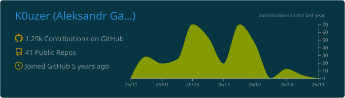
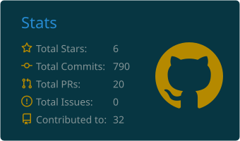
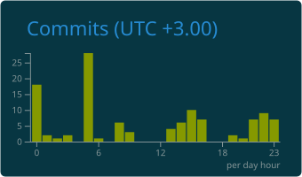
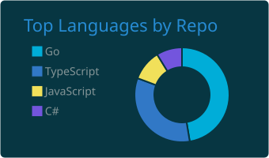
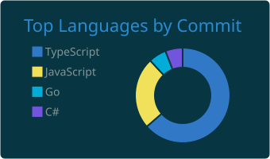

  <picture>
    <source media="(prefers-color-scheme: dark)" srcset="https://raw.githubusercontent.com/Flowseal/Flowseal/refs/heads/output/github-contribution-grid-snake-dark.svg" />
    <source media="(prefers-color-scheme: light)" srcset="https://raw.githubusercontent.com/Flowseal/Flowseal/refs/heads/output/github-contribution-grid-snake.svg" />
    
  </picture>

---

> Цель профиля — показать не «количество коммитов», а то, **какие задачи решаю** и с каким стеком.

---

  
  
  
  
  
  
  

### Frontend  basics

Показать 5 репозиториев

| Проект | Что внутри |
|:-------|:-----------|
| [**webpack**](https://github.com/K0uzer/webpack) | Сборка для React, TypeScript и SCSS. |
| [**ReactWebpackBeginningProd**](https://github.com/K0uzer/ReactWebpackBeginningProd) | Подготовка сборки приложения к production. |
| [**monorep-webpack**](https://github.com/K0uzer/monorep-webpack) | Монорепозиторий с пакетами и сервисами. |
| [**Auth-toolkit**](https://github.com/K0uzer/Auth-toolkit) | Инструменты авторизации на Next.js и Auth.js; проект в разработке. |
| [**learning**](https://github.com/K0uzer/learning) | Вопросы, задачи и ссылки для подготовки по JavaScript и React. |

### Go basics

Показать 18 репозиториев

| Проект | Что внутри | Состояние |
|:-------|:-----------|:----------|
| [**calc**](https://github.com/K0uzer/calc) | Интерактивная арифметика, ввод чисел и обработка ошибок. | Проверки пройдены |
| [**calculator**](https://github.com/K0uzer/calculator) | Пустая заготовка калькулятора; Go-кода пока нет. | Пустая заготовка |
| [**cli-calc**](https://github.com/K0uzer/cli-calc) | Указатель на локальную переменную; CLI-калькулятор оставлен в комментариях. | Проверки пройдены |
| [**defer**](https://github.com/K0uzer/defer) | Порядок отложенных вызовов и функция трассировки. | Проверки пройдены |
| [**factory**](https://github.com/K0uzer/factory) | Замыкания: сумматор, множитель и счётчик со сбросом. | Проверки пройдены |
| [**files**](https://github.com/K0uzer/files) | Заготовки чтения, нумерации и копирования файлов в комментариях; `main` пустой. | Проверки пройдены |
| [**filterOdd**](https://github.com/K0uzer/filterOdd) | Нечётные числа без нового backing array; табличные тесты. | Проверки пройдены |
| [**fizzbuzz**](https://github.com/K0uzer/fizzbuzz) | Циклы и условия; для кратных 15 выводится `BuzzBuzz`. | Проверки пройдены |
| [**indicator**](https://github.com/K0uzer/indicator) | Пустой срез; упражнения `swap` и `clamp` в комментариях. | Проверки пройдены |
| [**iota**](https://github.com/K0uzer/iota) | Константы размеров через `iota`; незавершённая `FormatSize`. | Не собирается |
| [**maps**](https://github.com/K0uzer/maps) | Группировка слов через `map` и функцию-классификатор. | Проверки пройдены |
| [**module**](https://github.com/K0uzer/module) | Вложенный `modtest`: Go Modules и русские заглавные буквы через `x/text`. | Проверки пройдены |
| [**onlyUnique**](https://github.com/K0uzer/onlyUnique) | Ограничение повторов Unicode-рун и фильтрация по предикату. | Не собирается |
| [**questionnaire**](https://github.com/K0uzer/questionnaire) | Консольная анкета: ввод, форматирование и работа с текущим годом. | Проверки пройдены |
| [**rune**](https://github.com/K0uzer/rune) | Повторение строки через `strings.Builder`; другие упражнения в комментариях. | Проверки пройдены |
| [**tests**](https://github.com/K0uzer/tests) | Разворот Unicode-строки, подсчёт слов и табличные тесты. | Падает тест |
| [**textanalyzer**](https://github.com/K0uzer/TextAnalyzer) | CLI-анализатор: слова, руны, частоты и топ слов; есть тесты. | Проверки пройдены |
| [**validationPass**](https://github.com/K0uzer/validationPass) | Тип-функция, метод и `slices.Delete`; тесты ждут закомментированные валидаторы. | Тесты не собираются |

### Go OOP / backend

Показать 9 репозиториев

| Проект | Что внутри | Состояние |
|:-------|:-----------|:----------|
| [**embedding**](https://github.com/K0uzer/embedding) | Встраивание `io.Writer`: обёртка добавляет временную метку. | Проверки пройдены |
| [**generics**](https://github.com/K0uzer/generics) | `Set`, `Reduce`, удаление дублей и функциональные опции. | Не собирается |
| [**http**](https://github.com/K0uzer/http) | CRUD API задач на `net/http` и JSON; данные хранятся в памяти. | Проверки пройдены |
| [**interfaces**](https://github.com/K0uzer/interfaces) | `io.Reader` и сканирование слов; `LineCount` фактически считает слова. | Проверки пройдены |
| [**json**](https://github.com/K0uzer/json) | JSON-теги статьи и незавершённые функции чтения и записи. | Не собирается |
| [**library**](https://github.com/K0uzer/library) | Заготовка библиотеки с `internal`-пакетом и незавершёнными конструкторами. | Не собирается |
| [**metods**](https://github.com/K0uzer/metods) | Методы, поиск и выдача книг; демонстрация выявляет ошибки хранения. | Проверки пройдены |
| [**structs**](https://github.com/K0uzer/structs) | Структуры `Book`, `Member`, `Library` и конструкторы с проверками. | Проверки пройдены |
| [**tests**](https://github.com/K0uzer/oop-tests) | Fake/stub-хранилище и заготовки тестов; несовместимость типов. | Не собирается |

## Snapshot

---

  
  

